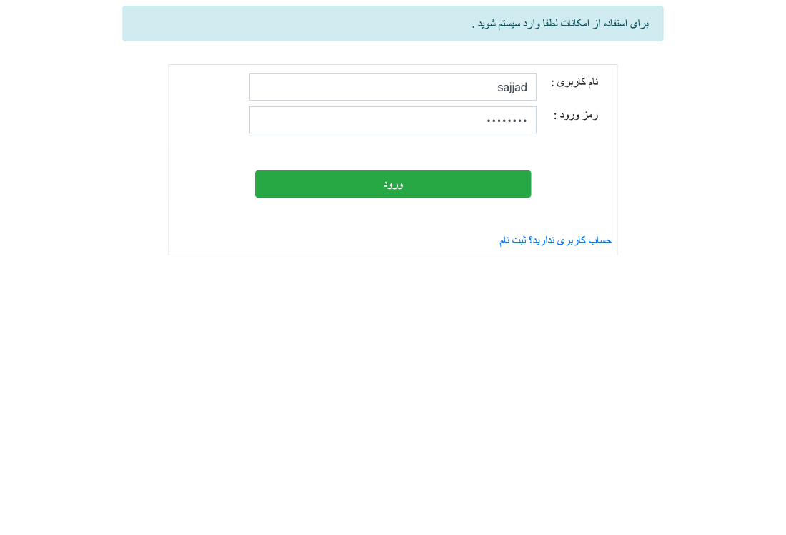
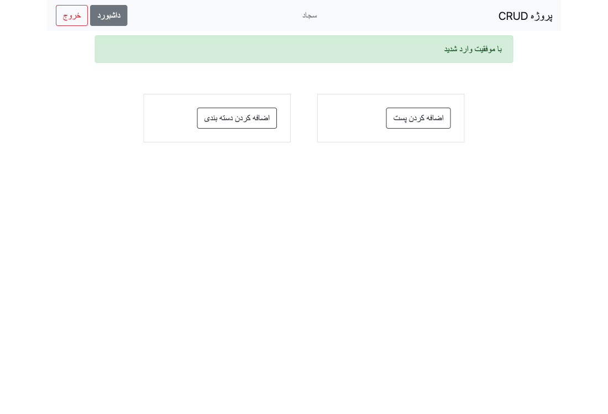
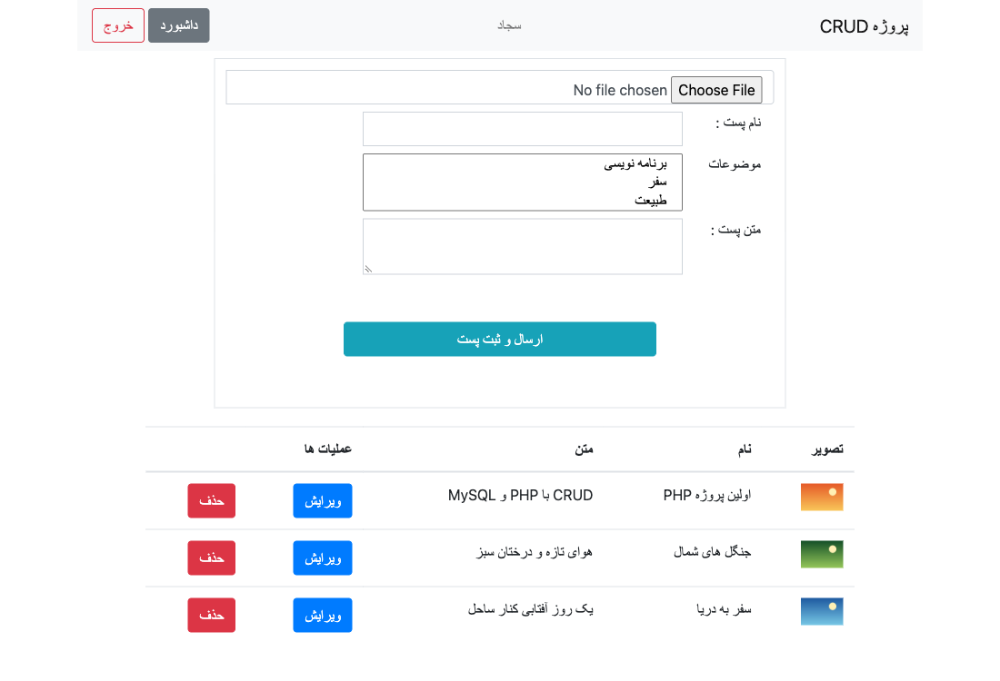
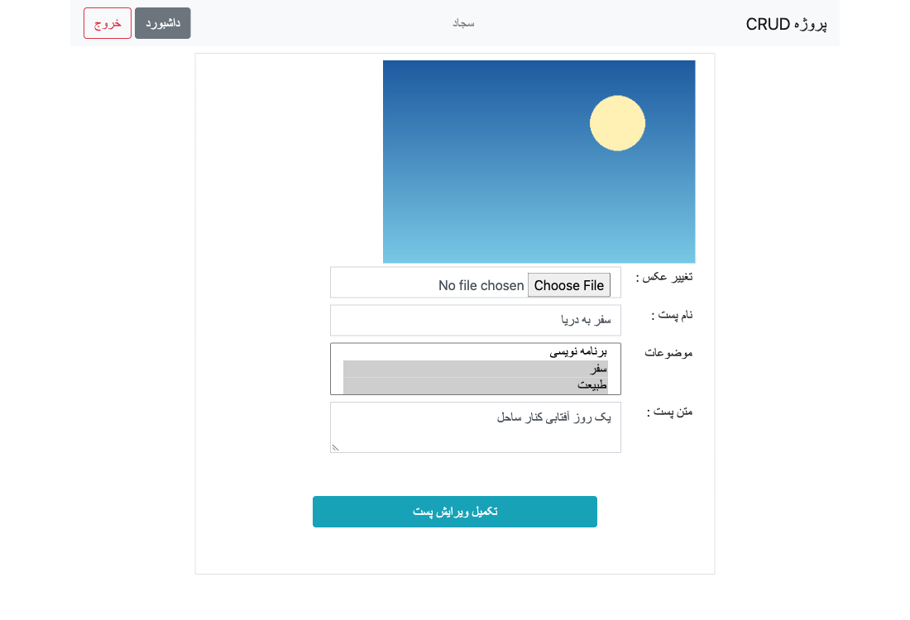
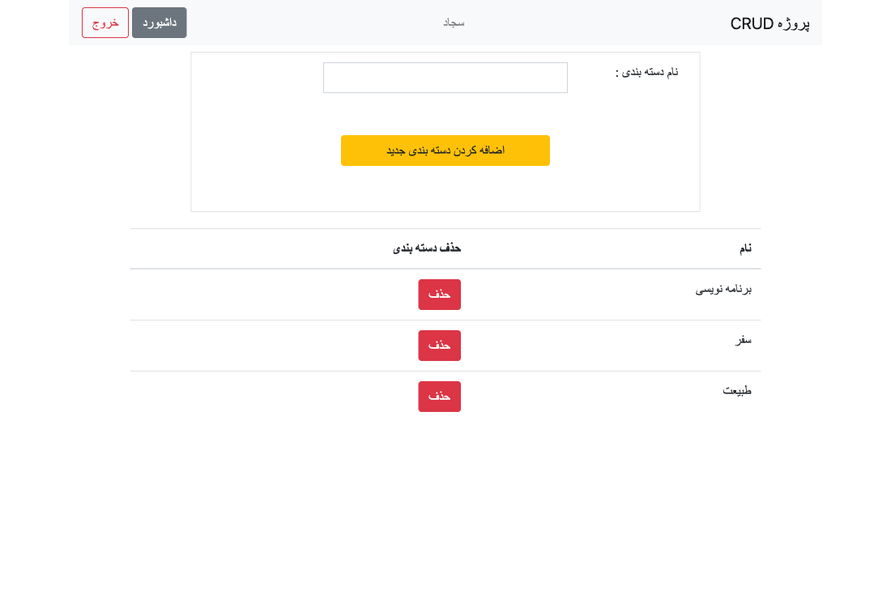
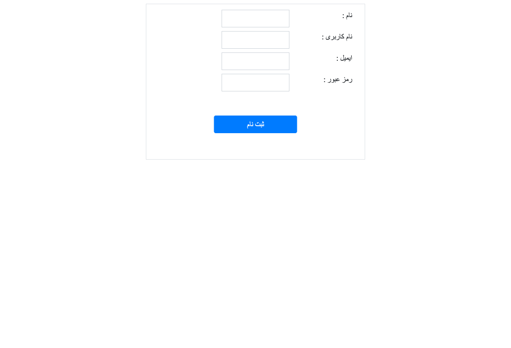

# vanilla-php-blog

My first PHP project: a small Persian (RTL) blog panel built with **vanilla PHP + mysqli**, no framework.

- Register / login / logout (sessions, hashed passwords)
- Categories: create, list, delete
- Posts: create, edit, delete, with an image upload and many-to-many categories

📘 **[LESSON.md](LESSON.md)** explains the mistakes in the first version and how each one was fixed:
SQL injection, password hashing, XSS, authorization, file uploads, and more.

## Screenshots

| Login | Dashboard |
|---|---|
|  |  |
| **Posts** | **Edit post** |
|  |  |
| **Categories** | **Register** |
|  |  |

## Project structure

```
Repository/   logic: database queries and form handling
  Config.php      database connection (reads environment variables)
  helpers.php     e(), redirect(), require_login(), flash(), query()
  UsersCRUD.php   register, login, logout
  CategoriesCRUD.php
  PostsCRUD.php
View/         pages (HTML + a little PHP)
  partials/header.php
images/       uploaded images (not in git)
schema.sql    database tables
```

## Run it

Requirements: PHP 8.1+ (with `mysqli` and `fileinfo`) and MySQL 5.7+/8 or MariaDB.

```bash
# 1. create the database and tables
mysql -u root -p < schema.sql

# 2. start the PHP built-in server with your database settings
DB_HOST=127.0.0.1 DB_USER=root DB_PASS=your-password php -S localhost:8000

# 3. open http://localhost:8000/View/Register.php
```

Available settings: `DB_HOST`, `DB_PORT`, `DB_USER`, `DB_PASS`, `DB_NAME` (default `crud`).

> Upgrading from the old version? Old accounts stored plain-text passwords and can't log in any more.
> Register again, or run `schema.sql` on a fresh database.
